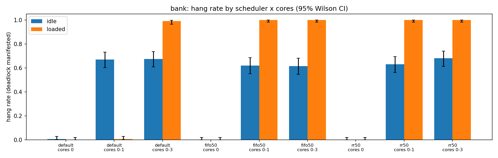
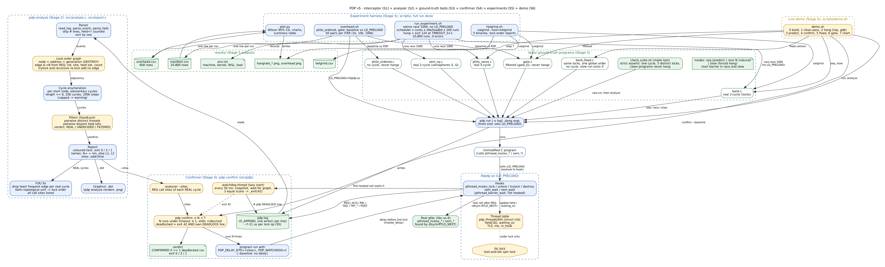

# Predictive Deadlock Profiler (PDP)

**We predict lock-order deadlocks from one run, confirm them, and measure how Linux scheduling decides whether they ever show up.**

PDP is an `LD_PRELOAD` library (`libpdp.so`) that records every `pthread_mutex_*` and `sem_*` call of an unmodified C program, an analyzer that builds a lock-order graph from that log and finds cycles (potential deadlocks) even when the run did not hang, a confirmer that re-runs the program with targeted delays to show the deadlock is real, and an experiment harness that measures how often the same bug manifests under different Linux scheduling policies, core counts and load. Predict-and-confirm is prior art (GoodLock 2000, DeadlockFuzzer PLDI 2009, Helgrind, ThreadSanitizer, Linux lockdep, ICSE 2020, PLDI 2023); our contribution is the scheduling study. Course project for an Operating Systems class, built with gcc on Linux (WSL2).





## Key Features

- **Predict from one clean run.** The interceptor logs lock events of a run that never hangs; the analyzer finds the lock-order cycle offline.
- **GoodLock-style filters.** Each cycle is classified REAL, UNDECIDED or FILTERED; cycles protected by a common gate lock, or whose edges all come from one thread, are filtered out.
- **Lock-order fix suggestion.** For each real cycle the report suggests a global acquisition order (the F(R) fix) and the call sites to change.
- **Directed-delay confirmer.** `pdp confirm` re-runs the program with delays at the cycle's lock sites; a wait-for watchdog thread reports a real deadlock instead of letting the run hang.
- **Scheduling study harness.** 10,800 native runs per platform across scheduler (default, FIFO, RR), core set and load, with 95% Wilson intervals.
- **Helgrind comparison.** The same programs run under Helgrind, so the value of the prediction is measured, not assumed.

## Quick Start

Requirements: gcc, make and python3. The demo also uses gdb (`sudo apt install gdb`); the experiment uses `taskset` and `chrt` (util-linux), and `plot.py` needs matplotlib.

```
make          # builds build/libpdp.so, build/pdp, build/pdp-analyze and tests/bin/*
make test     # ground-truth suite: predictions and hang checks on known programs
```

The bank example: a lock-order bug that a clean run does not show.

```
$ build/pdp run -o bank.log tests/bin/bank seq        # 1. record a clean run (it never hangs)
done: A=95 B=105

$ build/pdp analyze bank.log                          # 2. predict
PDP analysis: 2 locks, 2 edges
REAL potential deadlocks:
  [1] acct_a -> acct_b -> acct_a
      acct_a -> acct_b  tid 1819  at bank.c:57 (teller1)  holding {acct_a}
      acct_b -> acct_a  tid 1820  at bank.c:72 (teller2)  holding {acct_b}
Suggested fix:
  drop acct_a -> acct_b (seen 1x): change the call site(s):
      bank.c:57 (teller1) (tid 1819)
  acquire locks in this order: acct_b, acct_a

$ build/pdp confirm --log bank.log --baseline -n 10 tests/bin/bank race 1   # 3. confirm
cycle 1 (acct_a -> acct_b -> acct_a): deadlocked 10/10, hung 0, completed 0 -> CONFIRMED
  baseline (no delay): deadlocked 0/10, hung 0, completed 10
```

(Output trimmed; thread ids vary between runs.) For the live walkthrough used in the viva, run `scripts/demo.sh` (`DEMO_NOPAUSE=1` runs it straight through).

To run the experiment (native programs, no PDP, counting hangs):

```
RUNS=5 OUT_DIR=$(mktemp -d) scripts/run_experiment.sh   # smoke test; never write a smoke test into results/
sudo -E TIMEOUT_S=1 scripts/run_experiment.sh           # full run: 10,800 runs, ~1.5 h on the cloud VM, same 1 s timeout as the committed results
python3 scripts/plot.py                                 # hang-rate charts and summary
```

The full run needs root for the real-time policies (`chrt -f` / `chrt -r`). Without root the script tries `sudo -n`, and if that fails it skips the FIFO and RR cells with a warning. It refuses to run the RT configs if `sched_rt_runtime_us` is `-1`, because a spinning real-time thread could freeze the machine. All scripts refuse to overwrite an existing CSV unless `FORCE=1` is set. Details: `scripts/README.md`.

## Results

Two machines ran the same 10,800-run matrix (3 binaries x 3 schedulers x 3 core sets x 2 loads x 200 runs). **WSL2 is the primary result** (Intel Core Ultra 9 275HX laptop, the course platform, `results/wsl2/`). **A 4-vCPU cloud VM is the replication** (`results/cloud/`). Full tables, threats to validity and the unexplained differences are in [docs/stages/stage-5.md](docs/stages/stage-5.md).

**Findings that replicated on both platforms**

| finding | WSL2 (primary) | cloud (replication) |
|---|---|---|
| One core never shows the bug | 0 of 200 hung in all 18 one-core cells | 0 of 200 in all 18 |
| Default scheduler: load hides the bug (bank, 2 cores) | 67.0% idle to 0.5% loaded | 64.0% to 0.5% |
| FIFO/RR with load exposes it (bank and sem_sq, 2 or 4 cores, 16 cells) | 99.0% to 100.0% hung | 99.0% to 100.0% |
| bank, 2 cores, FIFO | 62.0% idle to 100.0% loaded | 75.0% to 100.0% |

**Differences, observed and not explained.** The four-core idle rates for bank and sem_sq are 57 to 68% on WSL2 against about 94% on the cloud. philo_naive on two real-time cores hangs in 0.5 to 2% of WSL2 runs against 43.5 to 72.5% on the cloud. The candidate causes are hypotheses, not findings.

**Overhead.** PDP adds 1.5 to 3.1 microseconds per lock operation on WSL2 (6.7 to 11.3 on the cloud), a 12x to 33x wall-time slowdown on lock-only microbenchmarks (18x to 141x on the cloud). The main cost is one `write()` per event; per-thread buffers are the planned fix.

**Helgrind versus PDP** (identical on both platforms):

| program | ground truth | Helgrind | PDP |
|---|---|---|---|
| bank | real 2-cycle | reports it | REAL |
| sem_sq | real 2-cycle on semaphores | misses it | REAL |
| philo_naive | real 5-cycle | reports it | REAL |
| gate | not a deadlock (gate lock) | false positive | FILTERED |
| philo_ordered | no cycle | no report | no cycle |

## How It Works

**Interceptor** ([stage 1](docs/stages/stage-1.md)). `libpdp.so` is loaded with `LD_PRELOAD` and replaces `pthread_mutex_*` and `sem_*`. Each call appends one event (thread, lock, call site, locks held) to a log file with a single `write()`.

**Analyzer** ([stage 2](docs/stages/stage-2.md)). `pdp-analyze` reads the log, builds a lock-order graph (an edge A to B means some thread took B while holding A), finds cycles, and applies the GoodLock filters. It prints the real cycles, the filtered ones, and a suggested lock order. The ground-truth programs and suite that check it are in [stage 3](docs/stages/stage-3.md).

**Confirmer** ([stage 4](docs/stages/stage-4.md)). `pdp confirm` re-runs the program with a delay injected at the predicted cycle's lock sites. A watchdog thread keeps a wait-for graph and reports a real deadlock; a baseline without the delay shows the delay is what makes it happen.

**Experiment** ([stage 5](docs/stages/stage-5.md), demo in [stage 6](docs/stages/stage-6.md)). The scripts run the real deadlock programs natively, with no PDP, under each scheduler, core set and load, with a 1 s timeout as the hang detector, and count hangs.

## Repository Layout

```
src/        libpdp.c (interceptor, watchdog, delay hook), pdp.h, analyze.c and report.c (analyzer), pdp (front end: run, analyze, confirm)
tests/      ground-truth programs (bank, bank_fixed, sem_sq, gate, philo_naive, philo_ordered, prodcons, recursive, ...), check_*.sh, logs/
scripts/    run_experiment.sh, overhead.sh, helgrind.sh, plot.py, runtime_ns.py, demo.sh   (see scripts/README.md)
results/
  wsl2/     primary: manifest.csv, overhead.csv, helgrind.csv, env.txt, charts
  cloud/    replication: the same files
docs/       README.md (index), stages/, reviews/, arch/ (arch-vN.dot and .png), CHANGELOG, VIVA, STATUS, TIMELINE, PROCESS
.claude/    agent role definitions used during the build
Makefile
build/      generated by make (not committed)
```

## Prior Art

- **GoodLock** (Havelund and Visser, 2000): the lock-order graph and cycle idea that most later tools build on.
- **DeadlockFuzzer** (Joshi, Park, Sen, Naik; PLDI 2009): predicts from a trace, then steers the scheduler at the cycle's statements to make the deadlock happen. This is predict-and-confirm.
- **Helgrind** (Valgrind): a lock-order and race checker run under emulation. Our baseline.
- **ThreadSanitizer** (Google): a compiler-instrumented race and lock-order checker.
- **Linux lockdep**: the kernel's lock dependency validator, which checks lock order at run time.
- **ICSE 2020**, "Low Overhead Deadlock Prediction": a prediction technique aimed at low run-time cost.
- **PLDI 2023**, "Sound Dynamic Deadlock Prediction in Linear Time": prediction with soundness and linear-time analysis.

We do not claim predict-and-confirm as a new method. Our contribution is the scheduling study: a measured answer, with confidence intervals, to how often a real deadlock shows up natively under different schedulers, core counts and loads.

## Limitations

- **Static and setuid binaries ignore `LD_PRELOAD`**, so PDP cannot see them.
- **Mutexes and semaphores only.** `pthread_cond_wait`, timed locks and other synchronisation are not modelled. Semaphores use a binary-semaphore model with no true owner.
- **`fork()` is not handled.** A forked child runs without the watchdog.
- **A confirmed deadlock is evidence, not proof.** One run that deadlocks shows the cycle can happen under the delay. Zero of N without the delay does not show it never does.
- **Overhead is high for lock-heavy code.** The 1.5 to 11 microseconds per operation (WSL2 to cloud) is measured on microbenchmarks only.
- **Two machines, two confounds.** The WSL2 run used randomised block order and `stress-ng` load; the cloud run used a fixed run order and bash busy-loop load, so machine and load generator both differ. WSL2 is itself a virtual machine, and its vCPUs are not physical cores.
- **The scheduler explanation is a hypothesis.** We did not trace the scheduler to prove why load hides the bug under the default policy and exposes it under real-time policies.

## Future Work

- A launcher that does not depend on `pdp run` (pipe, fork and exec handling), and `fork()` support.
- Runtime enforcement of the suggested lock order, not only advice.
- Read-write locks and condition variables in the model.
- eBPF or futex tracing, to measure the kernel side without an interceptor.
- A benchmark generator for random lock-order programs.
- CI/CD, so `make test` and the smoke experiment run on every push.
- Per-thread log buffers, to remove the write syscall from the lock path.

## Documentation

See the [documentation index](docs/README.md) for a recommended reading order. Key entry points: [stage 5](docs/stages/stage-5.md) (full results), [stage 6](docs/stages/stage-6.md) (demo and viva script), [VIVA.md](docs/VIVA.md) (glossary and examiner questions).

## How This Was Built

PDP was built in one day with Claude Code AI agents (an orchestrator and builder, reviewer, experimenter and docs agents) working under the author's direction; the roles, the review loop and the design changes the reviews caused are documented honestly in [docs/PROCESS.md](docs/PROCESS.md).

## Author

Pavitran V C
