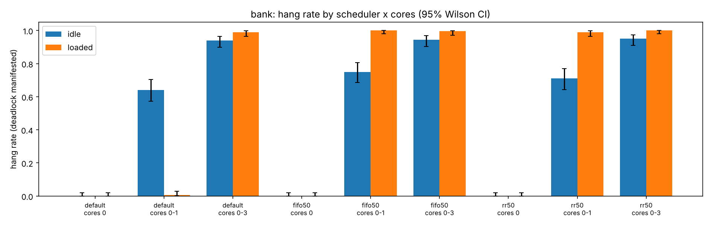
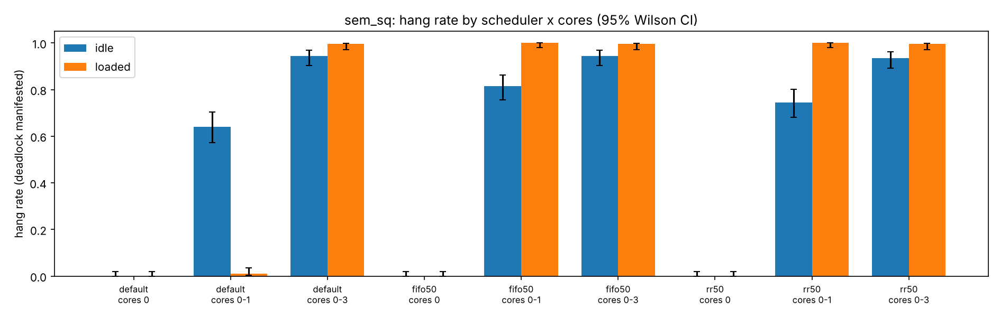
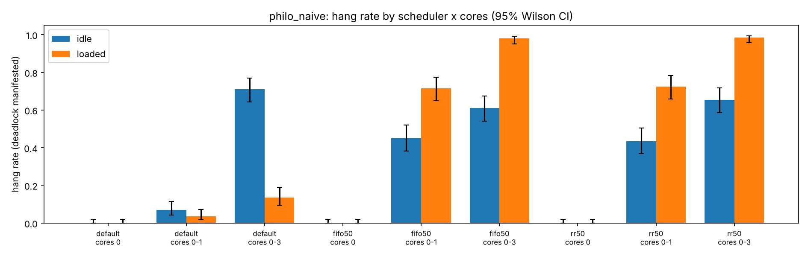
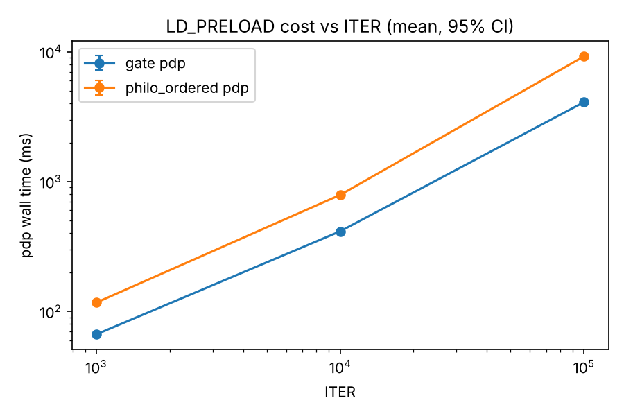

# Stage 5 — Experiment harness and results (how often does the bug show up?)

Status: full run done (10,800 runs, 0 errors) on a cloud VM, not WSL2. Scripts merged from the parallel session
(branch `ccr-b8583290-l43ezk-experiments`, commit `e969aba`, merge `7e357a9`); review in `docs/reviews/stage-5-6.md`;
review fixes applied to the scripts afterwards. **The full run used the pre-fix `run_experiment.sh`** (see "Honest
caveats"). Source: `scripts/run_experiment.sh`, `scripts/overhead.sh`, `scripts/helgrind.sh`, `scripts/plot.py`,
`scripts/runtime_ns.py`, `scripts/README.md`. Data: `results/manifest.csv`, `results/overhead.csv`,
`results/helgrind.csv`, `results/env.txt`. Charts: `results/hangrate_*.png`, `results/overhead.png`.

## What was built

Stages 1–4 show that a bug *can* happen. Stage 5 asks a different question: **with no PDP and no delay injection, how
often does the bug actually show up on a real machine, and what changes that rate?** It has four parts.

1. **`run_experiment.sh`**: runs each real-deadlock test program (`bank`, `sem_sq`, `philo_naive`) natively, with no
   `LD_PRELOAD`, in `race` mode with `ITER=1000`. A run that is still alive after `TIMEOUT_S` seconds is counted as
   **hung**. Each run is one row in `results/manifest.csv`. It varies three factors: scheduler (`default`, `fifo50`
   = `chrt -f 50`, `rr50` = `chrt -r 50`), core set (`taskset -c 0`, `0-1`, `0-3`), and load (`idle`, or `loaded` =
   one busy bash loop per core in the same core set).
2. **`overhead.sh`**: runs the clean programs `philo_ordered` and `gate` twice per pair, once plain and once with
   `LD_PRELOAD=build/libpdp.so`, and records wall time. It is the cost side of the tool.
3. **`helgrind.sh`**: runs Valgrind's Helgrind on the same programs. It is the baseline: what a standard tool says.
4. **`plot.py`**: reads the CSVs, computes hang rates with Wilson 95% intervals, draws the charts, and prints a table.

## Method

- **Race mode and start barrier.** `race N` creates the threads behind a `pthread_barrier_t`, so the threads start
  together. Without the barrier, race mode measured thread-creation stagger instead of the locking (Stage 3 note: the
  philo_naive rate was 0/20 natively without it, 10/10 under PDP). The barrier is not intercepted, so it adds no edges.
- **`ITER=1000`.** Each thread does 1000 rounds of lock, work, unlock. More iterations give each process more
  chances to hit the bad interleaving; we fixed it for the whole matrix so that only the factors change.
- **`TIMEOUT_S=1`.** A normal run is a few milliseconds. In this run the slowest `ok` run took 76 ms (99th percentile
  20 ms), and the fastest `hung` run took 1003 ms. The gap is more than 10x, so "still alive after 1 s" separates the
  two outcomes cleanly for this binary set. The timeout is the detector: exit 124 from `timeout(1)` means hung.
- **200 runs per cell.** One cell is one (binary, scheduler, core set, load) combination. Full matrix:
  3 binaries x 3 schedulers x 3 core sets x 2 loads x 200 runs = **10,800 runs**. Outcomes: 5,288 hung, 5,512 ok,
  **0 errors** (no crash, no exit status other than 0 or 124).
- **Wilson 95% interval.** Each hang rate is a binomial proportion, so each is reported with a Wilson score interval
  (z = 1.96) instead of the normal (Wald) interval. Wald gives a zero-width interval at 0/200 and 200/200, which is
  wrong; Wilson stays honest at the ends. Reference values checked in review: 0/10 gives [0, 0.2775], 5/10 gives
  [0.2366, 0.7634].
- **Machine.** `results/env.txt`: cloud VM (`uname` machine `vm`, kernel 6.18.44-fc-v139), 4 vCPUs, `wsl: no`,
  `container: no`, `stress_ng: none` (the load is bash busy loops), 200 runs per cell, `timeout_s: 1`, `iter: 1000`.

## Results: hang rate per binary (hung %, with Wilson 95% CI)

Each cell is 200 runs. "idle" is the test alone; "loaded" is the test with one busy loop per core in its core set.

### bank

| scheduler | cores | idle | loaded |
|---|---|---|---|
| default | 0 | 0.0 [0.0, 1.9] | 0.0 [0.0, 1.9] |
| default | 0-1 | **64.0** [57.1, 70.3] | 0.5 [0.1, 2.8] |
| default | 0-3 | 94.0 [89.8, 96.5] | 99.0 [96.4, 99.7] |
| fifo50 | 0 | 0.0 [0.0, 1.9] | 0.0 [0.0, 1.9] |
| fifo50 | 0-1 | 75.0 [68.6, 80.5] | **100.0** [98.1, 100.0] |
| fifo50 | 0-3 | 94.5 [90.4, 96.9] | 99.5 [97.2, 99.9] |
| rr50 | 0 | 0.0 [0.0, 1.9] | 0.0 [0.0, 1.9] |
| rr50 | 0-1 | 71.0 [64.4, 76.8] | 99.0 [96.4, 99.7] |
| rr50 | 0-3 | 95.0 [91.0, 97.3] | 100.0 [98.1, 100.0] |

### sem_sq

| scheduler | cores | idle | loaded |
|---|---|---|---|
| default | 0 | 0.0 [0.0, 1.9] | 0.0 [0.0, 1.9] |
| default | 0-1 | 64.0 [57.1, 70.3] | 1.0 [0.3, 3.6] |
| default | 0-3 | 94.5 [90.4, 96.9] | 99.5 [97.2, 99.9] |
| fifo50 | 0 | 0.0 [0.0, 1.9] | 0.0 [0.0, 1.9] |
| fifo50 | 0-1 | 81.5 [75.5, 86.3] | 100.0 [98.1, 100.0] |
| fifo50 | 0-3 | 94.5 [90.4, 96.9] | 99.5 [97.2, 99.9] |
| rr50 | 0 | 0.0 [0.0, 1.9] | 0.0 [0.0, 1.9] |
| rr50 | 0-1 | 74.5 [68.0, 80.0] | 100.0 [98.1, 100.0] |
| rr50 | 0-3 | 93.5 [89.2, 96.2] | 99.5 [97.2, 99.9] |

### philo_naive (5 philosophers, naive fork order)

| scheduler | cores | idle | loaded |
|---|---|---|---|
| default | 0 | 0.0 [0.0, 1.9] | 0.0 [0.0, 1.9] |
| default | 0-1 | 7.0 [4.2, 11.4] | 3.5 [1.7, 7.0] |
| default | 0-3 | 71.0 [64.4, 76.8] | 13.5 [9.4, 18.9] |
| fifo50 | 0 | 0.0 [0.0, 1.9] | 0.0 [0.0, 1.9] |
| fifo50 | 0-1 | 45.0 [38.3, 51.9] | 71.5 [64.9, 77.3] |
| fifo50 | 0-3 | 61.0 [54.1, 67.5] | 98.0 [95.0, 99.2] |
| rr50 | 0 | 0.0 [0.0, 1.9] | 0.0 [0.0, 1.9] |
| rr50 | 0-1 | 43.5 [36.8, 50.4] | 72.5 [65.9, 78.2] |
| rr50 | 0-3 | 65.5 [58.7, 71.7] | 98.5 [95.7, 99.5] |

## Key findings

**1. One core: 0% everywhere.** On `taskset -c 0`, all 3 binaries, all 3 schedulers and both loads gave 0/200. This
is a measured result, and we only have a hypothesis for it. A run lasts a few milliseconds. The bad interleaving needs
one thread to be preempted in the short window where it holds the first lock and the other thread is running. With
one core the scheduler has few chances to do that inside such a short run. Under `fifo50` and `rr50` it is even less
likely: FIFO never preempts a thread for another thread of the same priority, and the RR quantum (100 ms) is much
longer than a run. We did not trace preemption points, so this is an explanation to test, not a proof.

**2. More cores, more manifestation.** Going from 2 to 4 cores raised the idle rate for all three binaries and every
scheduler (for example bank default 64% to 94%). Two threads can then really run at the same time, so their first and
second lock requests overlap more often.

**3. Load hides the bug under the default scheduler.** This is the surprising one. With one busy loop per core on
`0-1`, bank falls from 64.0% (idle) to 0.5% (loaded), sem_sq from 64.0% to 1.0%, and philo_naive from 7.0% to 3.5%.
On `0-3`, philo_naive falls from 71.0% to 13.5%. A plausible mechanism, **a hypothesis we did not prove**: under CFS or
EEVDF, the busy loops take their share of each core. The two tellers then get the CPU in turns, each gets a slice,
and runs its loop quickly, so their lock windows rarely overlap. The bug needs the threads to run *side by side*, and
the load serialises them.

**4. Load exposes the bug under real-time scheduling.** Under `fifo50` and `rr50`, the same load pushes the rate up:
bank on `0-1` goes from 75.0% to 100.0% (FIFO) and from 71.0% to 99.0% (RR); philo_naive on `0-3` goes from 61.0% to
98.0% (FIFO). Mechanism, again a **hypothesis**: the test threads and the spinners run at different priorities.
An RT thread preempts a normal-priority spinner as soon as it is runnable, so both tellers run truly in parallel on
their cores, and the bad interleaving becomes common. The same load therefore has opposite effects under the two
policies. Caveat from the review: under RT, `loaded` means CFS spinners that RT threads always preempt, so the
idle/loaded contrast means something different there than under `default`.

**5. The bug is not uniform.** sem_sq and bank behave alike: near 100% once two cores and load (under RT) are involved.
philo_naive is much less sensitive under the default scheduler (7% on 2 cores idle). Our guess, not measured: a
5-philosopher cycle needs all five threads to be in the right phase at once, which is less likely per run than two
threads meeting in the right phase.

## Overhead: what PDP costs

`scripts/overhead.sh` runs `philo_ordered` and `gate` (lock-dominated microbenchmarks), 50 pairs per cell, with
`ITER` = 1000, 10000 and 100000. Within each pair the order (baseline first or PDP first) is random. All 600 rows are
`ok`. The per-lock-operation cost is `(t_pdp - t_baseline) / lock_ops` from the same pair.

| binary | ITER | median ns per lock op | baseline wall (median) | PDP wall (median) | ratio |
|---|---|---|---|---|---|
| gate | 1000 | 10.4 us | 3.6 ms | 66.8 ms | 18x |
| gate | 10000 | 6.9 us | 7.8 ms | 420.6 ms | 54x |
| gate | 100000 | 6.7 us | 64.2 ms | 4068 ms | 63x |
| philo_ordered | 1000 | 11.3 us | 3.7 ms | 117.6 ms | 32x |
| philo_ordered | 10000 | 7.7 us | 7.9 ms | 775.2 ms | 99x |
| philo_ordered | 100000 | 9.0 us | 64.3 ms | 9056 ms | 141x |

So the median cost is **about 7 to 11 us per lock operation**, and the wall-time slowdown is **18x to 141x**. The
slowdown is large because these programs do almost nothing but lock. A real program that does real work between locks
would see a much smaller ratio. The per-op figure is the number to quote.

**Why it is slow.** Each hooked call does one `write()` system call for the log event (so each lock costs a kernel
crossing), takes a spin lock on the thread table, and calls `dladdr` on every call to name the call site. We have not
profiled the split between these three; the `write()` syscall is the likely largest part, and that is a hypothesis.
**Future work:** per-thread in-memory buffers, flushed at exit, so a lock costs no syscall. That is the obvious next
step, and it is not built.

## Helgrind baseline

Helgrind (Valgrind's thread checker, `valgrind --tool=helgrind`) reports lock-order violations when it runs the program
under its own analysis. We ran it on the same binaries (`results/helgrind.csv`):

| binary | ground truth | Helgrind: lock-order violation reported | PDP (Stages 2–4) |
|---|---|---|---|
| bank | real 2-cycle | yes (1 report) | REAL, confirmed |
| philo_naive | real 5-cycle | yes (1 report) | REAL, confirmed |
| sem_sq | real 2-cycle on semaphores | **no** (0) | REAL, confirmed |
| gate | filtered (common gate lock) | **yes (1), a false positive** | FILTERED (gate lock) |
| philo_ordered | no cycle | no (0) | no cycle |

Three things to say about this table:
- **Helgrind misses sem_sq.** It tracks lock order for mutexes and does not model the lock-order semantics of
  semaphores, so the semaphore cycle is invisible to it. PDP treats `sem_wait` and `sem_post` as a lock edge.
- **Helgrind flags gate.** Helgrind has no notion of a gate lock, so it reports the two orders even though both are
  taken under one lock and cannot interleave. PDP's filter checks the held sets and removes this case.
- **Helgrind reports one line per lock pair.** The philosopher 5-cycle appears as one report line, not five.

## Review fixes (`docs/reviews/stage-5-6.md`)

The reviewer found 4 MUST-FIX items, 11 SHOULD-FIX and 10 NIT items. Items fixed in `scripts/` (checked in the code):

- **Ctrl-C mislabels data (MUST 1).** `run_experiment.sh` now has `trap stop_load EXIT` and `trap 'exit 130' INT TERM`.
  A signal exits the script, so the rest of the matrix is not written as `loaded` when it ran idle.
- **Results overwritten (MUST 2).** `run_experiment.sh`, `overhead.sh` and `helgrind.sh` refuse to start if their CSV
  exists, unless `FORCE=1` is set.
- **Overhead ignores exit status (MUST 3).** `overhead.csv` has an `rc` column and an `outcome` column; error rows are
  excluded from the statistics. The overhead script also now sweeps `ITER`, uses `perf_counter_ns` (`scripts/runtime_ns.py`) instead of integer
  milliseconds, and randomises the pair order (MUST 4).
- **Exit codes merged into `hung` (SHOULD 5).** Raw `rc` is recorded. 124 is `hung`. 137 is `hung` only if the elapsed
  time reached `TIMEOUT_S`, and `killed` otherwise, because an external SIGKILL (OOM, `kill -9`) is not a hang.
- **Order effects (SHOULD 6).** Randomised blocks: `RUNS` is split into blocks of 10; each block visits every cell once in a
  seeded order (`shuf --random-source`). Manifest has `block` and a per-run `ts`. **Not used for the full run above.**
- **RT safety (SHOULD 7).** `sched_rt_runtime_us` is read, written to `env.txt`, and RT configs are skipped if it is `-1`.
- **env.txt (SHOULD 8).** Now records the git commit (with a dirty flag), CPU model, governor, block size and
  `sched_rt_runtime_us`.
- **Demo (SHOULD 13, 14, 15, NIT 17).** The demo prints the ptrace reason and the fix, checks that `bank slow` actually
  hung, traps INT/TERM to exit 130, and prints colours only when stdout is a terminal.

Not verified in this stage and still open: the `error` column in `plot.py` (SHOULD 9), the max-elapsed validity table
(SHOULD 10, the data for it is in this document), and the NIT items. See the review file.

## Honest caveats about the full run

- **The full run used the pre-fix `run_experiment.sh`.** Cells ran in a fixed nested order (binary, scheduler, cores,
  load). Each cell's 200 runs were back-to-back, and `loaded` always came straight after `idle`. The manifest
  header has no `rc`, `block` or `ts` column, which confirms it. Over a multi-hour run, drift (host activity, thermal
  or turbo state, page cache) is confounded with the factor that changes. An effect such as "fifo50 looks different"
  might be "fifo50 ran at a different hour". The randomised-block design exists to remove that confound, and the
  WSL2 rerun uses it. Until then, treat the differences between cells as strong hints, not as settled.
- **The overhead CSV uses the reviewed script** (it has `order`, `rc` and `ns_per_lock_op` columns, and sweeps `ITER`).
- **The scripts README mentions a 5 s timeout** in places. This run used `TIMEOUT_S=1` (recorded in `env.txt`), which
  is what the timing argument above relies on.

## Threats to validity

- **Cloud VM, not WSL2.** The target platform in the course is WSL2 (see the README). This run is on a cloud VM with a
  different kernel. Absolute rates are not comparable across the two; the scheduler and core-count *trends* are the
  claim. The WSL2 rerun will check them.
- **WSL2 is itself a VM.** vCPUs are scheduled by the Hyper-V host underneath Linux, so "core 0" is not a physical
  core and an extra, invisible scheduler adds noise.
- **No stress-ng.** The load is bash busy loops, one per core. They are default-policy processes, and they are not the
  same as a real workload. A load that blocks, yields or does I/O would give different numbers.
- **Microbenchmarks for overhead.** `philo_ordered` and `gate` are almost all lock calls. The 18x to 141x ratio is
  an upper bound for this kind of program, not the cost for a real application.
- **ITER is fixed at 1000.** The rate depends on ITER, and we did not sweep it for the hang rates (only for overhead).
- **Timeout as hang detector.** A run slower than 1 s but still alive would be misclassified. The margin in this run
  (76 ms slowest ok, 1003 ms fastest hung) makes that unlikely, but it is an assumption.
- **RT needs privileges.** `chrt -f/-r` needs root or `CAP_SYS_NICE`; the script uses `sudo -n` and skips RT if that
  fails. In this run RT ran as root.
- **Sequential order** in the full run (see the caveats above).
- **Pinning.** `taskset -c 0` forces the threads to interleave only by preemption. That is the point of the one-core
  result, but it is not how real programs are normally run.

## Explain it in the viva

We ran the three real deadlock programs 10,800 times, with no tool attached, and counted how often each one hung. The
result is that the bug never shows on one core and shows in most runs on several idle cores, but **the load does
something different depending on the scheduler**. Under the normal Linux scheduler, a busy loop on every core makes the
bug almost disappear, because the loops take turns with the tellers and the two threads never run side by side. Under
real-time scheduling, the same loop makes it nearly certain, because real-time threads push the busy loops aside and
both tellers run at once. We think that explains it, but we did not trace the scheduler to prove it.

On the cost side, PDP adds about 7 to 11 microseconds to each lock operation, because each event is written to a file
with a system call. On a program that does nothing but lock, that is a slowdown of 18 to 141 times. On a real program,
much less. The fix is per-thread buffers, which are future work.

The comparison with Helgrind shows what the prediction adds: Helgrind misses the semaphore cycle and flags the gate
case that is not a deadlock. PDP finds both correctly.

Finally, the honest limits: this data came from a cloud VM, not the WSL2 machine the course uses; the full run used
the older script with a fixed order, so some differences could be time-of-day effects; and the scheduler explanation
is a hypothesis.
